# mAIPAL: l'app (frontend)

Questo documento descrive l'app che l'utente vede e usa: stile, impaginazione, pagine, comportamenti e le chiamate al server. È il complemento di `docs/PROGETTO.md`, che descrive il progetto intero e i modelli di intelligenza artificiale.

Le schermate sono in `docs/screens/`:
- `m…` = telefono (390×844);
- `d…` = computer (1440×900).

Sono state fatte con dati di prova: l'artigiana «Anna Rossi», dell'organizzazione «Rossi Impianti».

---

## 0. La cosa più importante: l'interfaccia non va rifatta

**Il frontend non parla mai con un modello di intelligenza artificiale.** Parla solo con il server mAIPAL (`/api/...`), con 286 chiamate in tutto, elencate nel capitolo 9. Tutto il lavoro dei modelli avviene nel server.

Per **cambiare il modello che interpreta i messaggi** quindi:
- **il frontend resta com'è**: stesso codice, stesse pagine, stesso aspetto;
- il server deve continuare a rispondere **alle stesse chiamate, con gli stessi dati nello stesso formato**. Questo è il «contratto» del capitolo 9.

L'unica modifica all'app che serve per l'obiettivo «scrivi e basta» è in `frontend/src/pages/ChatPage.jsx`: una modalità **Automatico** in cui non si sceglie l'agente (vedi `PROGETTO.md`, capitolo 8). Il resto dell'interfaccia non cambia.

Se invece l'app va **ricostruita da zero** in un altro progetto, questo documento, le schermate e il codice in `frontend/src` sono la specifica. Il codice resta la fonte esatta: misure, testi e colori sono tutti lì.

---

## 1. Tecnologie

| Cosa | Con cosa |
|---|---|
| Interfaccia | **React 19** (`react`, `react-dom` 19.0.0), compilato con **CRA + craco** (`@craco/craco` 7.1, `react-scripts` 5) |
| Stili | **Tailwind CSS** 3 + `frontend/src/index.css` (circa 900 righe: palette, vetro, sfondi, tema chiaro) |
| Componenti base | **shadcn/ui** su Radix (`frontend/src/components/ui/*`), **sonner** per i messaggi a comparsa (toast) |
| Icone | **lucide-react** 0.516 (tratto sottile, 16–22 px) |
| Pagine | **react-router-dom** 7: `BrowserRouter` con `basename=/general` |
| Chiamate al server | **axios** (`src/lib/api.js`, cookie di sessione); `fetch` per lo streaming della chat e per i caricamenti |
| 3D | **three.js** 0.128, caricato solo quando serve: le «gocce» degli agenti e la realtà aumentata dei QR |
| Mappe | **maplibre-gl** 4.7: la mappa del cantiere nel diario di commessa |
| QR | `jsqr`, `js-aruco2` (lettura e realtà aumentata) |
| App installabile | PWA: `public/manifest.json`, `public/sw.js` (service worker), `src/lib/pwa.js` (installazione e notifiche push) |
| Senza rete | `src/lib/outbox.js` (IndexedDB: le voci del diario si inviano quando torna la rete), `src/components/OfflineStrip.jsx` |

**Compilazione**: `PUBLIC_URL=/general REACT_APP_BACKEND_URL=https://<dominio>/general npx craco build`. Il risultato è servito da nginx (`frontend/Dockerfile`).

---

## 2. Stile grafico

### 2.1 Colori e sfondo

- **Sfondo dell'app** (tema scuro, quello predefinito): uno sfondo «liquido» fatto di macchie di colore molto sfocate che si muovono lentamente, viste attraverso un vetro color vinaccia (`PageBackground.jsx`, classi `.liquid-page-bg`, `.liquid-blob-1…9`, `.liquid-tint` in `index.css`):
  - base chiara calda `#E6E1DC`;
  - macchie: vinaccia `#8E2F6B`, arancio `#F2701E`/`#FF8A3D`, rosa `#C2457F`/`#E9A7B8`, pesca `#F4C9A8`, azzurro polvere `#CBDFE4`;
  - in alto prevale il vinaccia/rosa, in basso l'arancio caldo, con azzurro negli angoli;
  - su schermo largo le macchie sono più piccole e più sfocate.
- **Ripiego** (iOS, rimbalzo della pagina): gradiente `linear-gradient(165deg, #B9A3B3 0%, #A64A80 30%, #93306C 52%, #C85A33 76%, #BDB1BB 100%)`.
- **Testo**: bianco `#FFFFFF`, con le gradazioni Tailwind `text-white/85`, `/65`, `/55`, `/45` per le informazioni secondarie.
- **Colori degli agenti** (`ACTION_COLOR` in `ChatPage.jsx`):

| Agente | Colore |
|---|---|
| Cerca | `#DD772F` |
| Salva | `#6D6181` |
| Task | `#7C6A7D` |
| Diario / Diario di commessa | `#8E2E11` |
| Report | `#A0672E` |
| Referto | `#2E7D63` |
| Lezioni | `#B0476E` |
| Azioni | `#3E7C8C` |
| Help | `#5B6FA8` |
| Modifica lista | `#2E5F7D` |

- **Pulsante principale**: fondo bianco al 90% con testo vinaccia `#7A2A5C`.
- **Interruttori**: verde iOS `#34C759`.
- **Avvisi**: giallo `#F2C14E` (limite pieno), toni ambra; rosso chiaro per le azioni che cancellano.

### 2.2 Vetro (le superfici)

| Classe | Dove | Com'è |
|---|---|---|
| `.card-soft` | schede delle pagine | bianco 6%, bordo bianco 15%, raggio 20 px, sfocatura 20 px |
| `.lg-glass` | pulsanti tondi (avatar, «+») | bianco 18%, sfocatura 18 px, ombra vinaccia leggera |
| `.lg-goo` / `.lg-frost` | barra in basso, casella di scrittura, schede della cronologia | velo bianco 20→10%, sfocatura 18 px |
| `.lg-bubble` | la «bolla» sotto la sezione attiva | bianco 26%, scorre con un rimbalzo (`cubic-bezier(.34,1.4,.64,1)`) |
| `.glass-panel` | menu, fogli dal basso, popup | vetro **scuro** fumé (`rgba(26,6,22,.5)`, sfocatura 36 px, luminosità 0.72), raggio 28 px, righe separate da linee sottili (`.glass-row`) |
| `.chat-input-card` | casella di scrittura su computer | bianco 8%, sfocatura 24 px |

### 2.3 Caratteri e misure

- **Carattere**: **Poppins** (Google Fonts), pesi 200–800. Inter solo nel dettaglio dei to-do.
- **Titoli di pagina**: 24–30 px, grassetto. **Testo**: 13–15 px. **Note**: 11–12 px.
- **`.kicker`**: etichetta 11 px, maiuscolo, spaziatura 0.18em, bianco 70% (per esempio «NOVEMBRE», «CODICE»).
- **Misure in pixel interi**. Campi alti 44 px (`h-11`), raggio 12 px; schede con raggio 20 px; pulsanti tondi 36–64 px.
- **Moduli** (`src/components/FormFields.jsx`):
  - etichetta sopra (12 px), campo con l'icona a sinistra;
  - menu a tendina nativi con la freccia, invece di file di pulsanti che vanno a capo;
  - pulsanti larghi `PRIMARY` / `SECONDARY` / `DANGER`;
  - titoletti sopra le schede (`GroupTitle`), indicatori numerici (`StatTiles.jsx`), interruttori iOS (`IosSwitch.jsx`).
- **Un solo punto di passaggio** tra telefono e computer: **1100 px** (`tailwind.config.js`: `md` = `lg` = 1100 px; `src/hooks/use-is-mobile.js`). Sotto si vede l'app del telefono, sopra quella da computer.

### 2.4 Tema chiaro

- Si sceglie dal menu del profilo (sole/luna) e viene salvato sul dispositivo (`maipal-theme`).
- Imposta `data-theme="light"` su `<html>`: pagina bianca, testi scuri `#211D28`.
- `index.css` ha una regola di «ri-inchiostro» per **ogni** classe bianca usata (`text-white/60`, `bg-white/10`, `border-white/15`…). Menu e fogli restano di vetro scuro.
- Schermata: `screens/m28-tema-chiaro.jpg`.

### 2.5 Le gocce degli agenti

- Sul telefono, accanto al nome dell'agente, c'è una **goccia 3D animata** (three.js, `src/components/agentDrop/`), con colori, occhi e accessori propri:
  - Cerca ha gli occhiali;
  - Report ha il caschetto;
  - Azioni ha la mascherina.
- La goccia «ascolta», «pensa» e «parla» (`STATES` in `agentDrop/config.js`). Su un telefono senza WebGL non compare.

---

## 3. Impaginazione

### 3.1 Telefono (sotto 1100 px)

 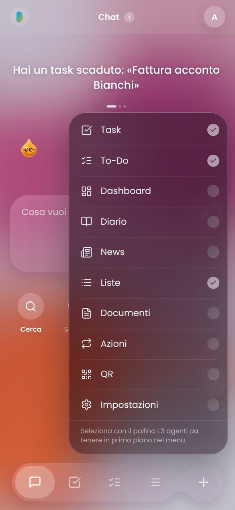 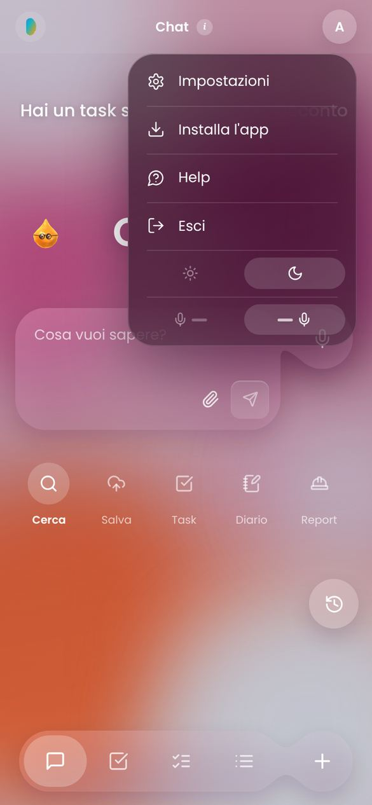

- **Barra in alto** (56 px più la zona di stato dell'iPhone), sottile e di vetro:
  - a sinistra il **logo** (la goccia mAIPAL con un'onda di colore che scorre);
  - al centro il **nome della sezione** con la **«i»** (apre la spiegazione della sezione, `HelpSheet.jsx`);
  - a destra l'**avatar** (foto o iniziale).
- **Barra in basso «liquida»** (`LiquidDock.jsx`): una pillola di vetro con **Chat + 3 sezioni** scelte dall'utente, unita come due gocce che si fondono al pulsante tondo **«+»**.
  - Le sezioni predefinite sono Task, Liste e Diario (chi aveva fissato To-Do trova il Diario al suo posto: i To-Do sono dentro Task). Una bolla di vetro scorre sotto la sezione attiva.
  - **Si nasconde mentre si scrive**: quando la tastiera è aperta. Ricompare 350 ms dopo, così un tocco non finisce sulla barra.
- **Menu «+»**: pannello di vetro scuro con tutte le sezioni. Il **pallino** a destra di ognuna la mette o la toglie dalla barra in basso (massimo 3).
- **Menu del profilo** (tocco sull'avatar): Impostazioni, Installa l'app, Help, Esci; poi il **tema** (sole/luna) e il **lato del microfono** nella chat (sinistra/destra).
- **Banner «Installa mAIPAL come app sul telefono»**: sopra la barra, finché non si installa o lo si chiude.
- **Striscia «senza rete»** in alto quando manca la connessione (`OfflineStrip.jsx`).
- Le pagine hanno 16 px di margine laterale e spazio in fondo per non finire sotto la barra.

### 3.2 Computer (da 1100 px)

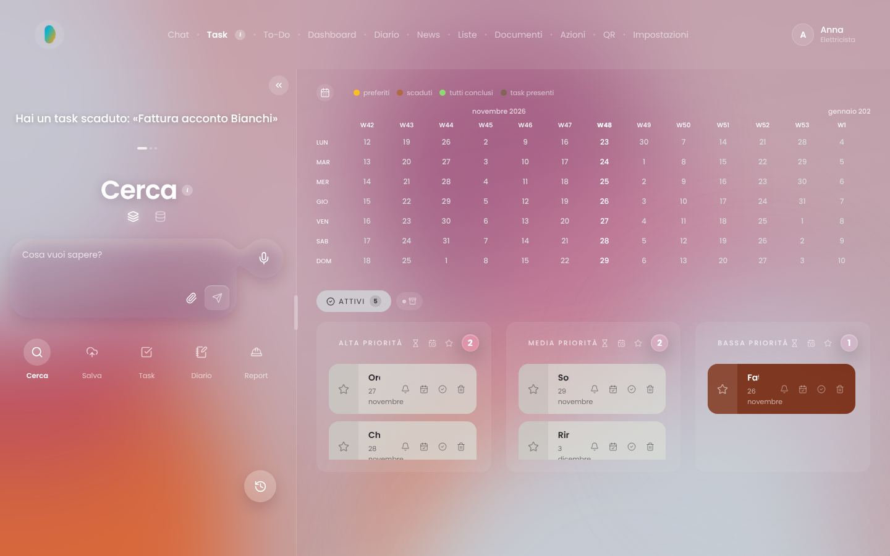

- **Intestazione** con il logo, **tutte le sezioni** in fila separate da «•» (quella attiva in grassetto, con la sua «i») e l'avatar con nome e professione.
- **Vista divisa**:
  - **a sinistra la chat**, la stessa del telefono. È larga da 360 px a un terzo della finestra, si allarga trascinando il bordo e si nasconde con ««» (poi c'è il pulsante «Chat»);
  - **a destra la sezione scelta**.
  - Larghezza e scelte restano sul dispositivo.
- Il comando «Chat» nell'intestazione apre la **cronologia** nella colonna della chat.

### 3.3 Le sezioni e chi le vede (`NAV_ITEMS` in `DashboardLayout.jsx`)

| Sezione | Indirizzo | Chi la vede |
|---|---|---|
| Chat | `/dashboard/chat` | tutti |
| Task | `/dashboard/tasks` | tutti |
| To-Do | `/dashboard/todos` → porta a `/dashboard/tasks?v=todo` (non è più nel menu) | tutti |
| Dashboard | `/dashboard/oggi` | artigiano |
| Diario | `/dashboard/journal` | tutti: per l'artigiano è il **diario di commessa**, per gli altri il diario personale |
| News | `/dashboard/news` | tutti |
| Liste | `/dashboard/liste` | tutti |
| Documenti | `/dashboard/documents` | tutti |
| Azioni | `/dashboard/azioni` | tutti |
| QR | `/dashboard/qr` | amministratori |
| Fitness | `/dashboard/fitness` | fitness |
| Impostazioni | `/dashboard/settings` | tutti |
| (fuori dall'app) | `/` accesso, `/onboarding` primo avvio, `/q/:codice` scansione di un QR | |

---

## 4. Le pagine

### 4.1 Accesso (`LoginPage.jsx`, `/`)

 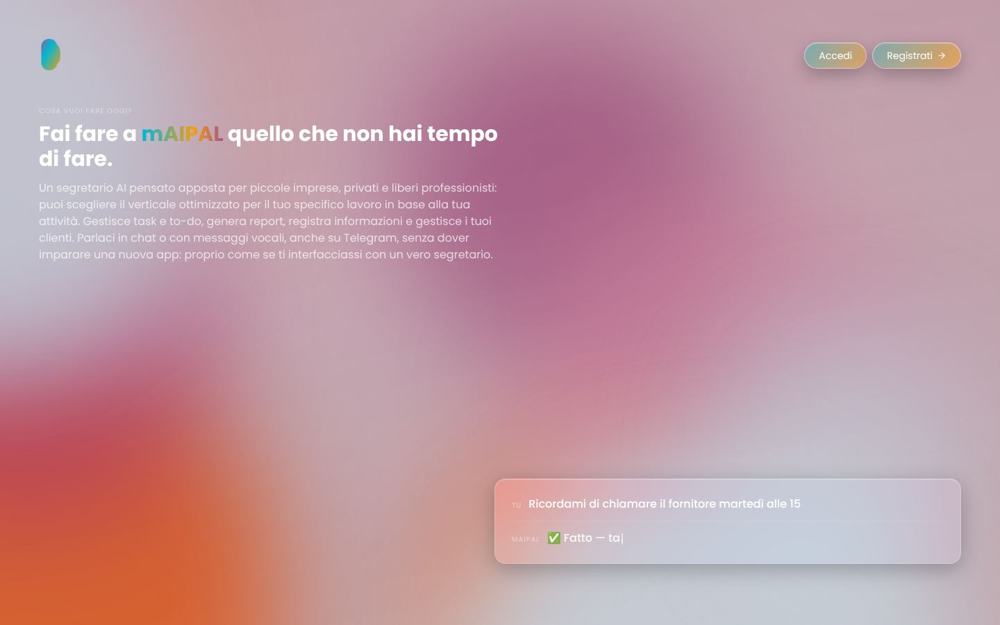

- Sfondo liquido animato e titolo «Fai fare a **mAIPAL** quello che non hai tempo di fare.», con mAIPAL in un'onda di colore.
- In alto i pulsanti di vetro **Accedi** e **Registrati**. Si entra con Google, oppure con email e password.
- In basso, una scheda di esempio di chat che cambia da sola.
- Dopo l'accesso si va al **primo avvio** (`OnboardingPage.jsx`: professione, settore, interessi) oppure alla chat.

### 4.2 Chat (`ChatPage.jsx`, la pagina principale)

   
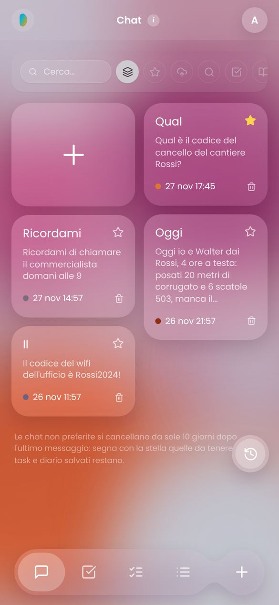 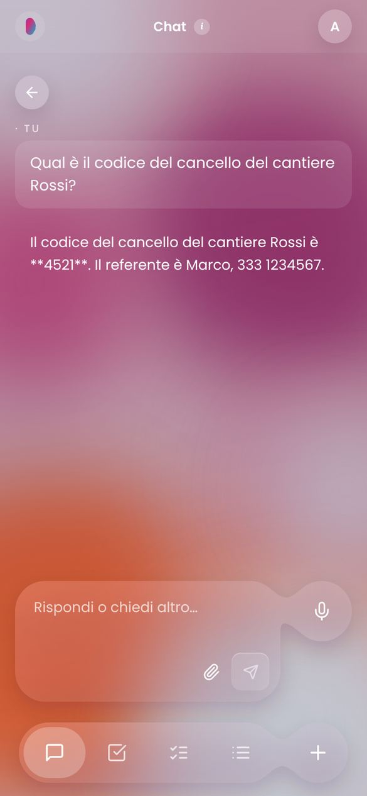

Sul telefono è costruita come la pagina iniziale di un browser. Dall'alto:

1. **Suggerimenti** (`SuggestionsTicker.jsx`): frasi che scorrono, con i pallini, per esempio «Hai un task scaduto: …». Toccandole si apre la cosa citata.
2. **Il nome dell'agente** scelto, grande (per esempio «Cerca»), con la **goccia** a sinistra e la **«i»**.
   - La «i» apre un foglio con: cosa fa l'agente, il significato delle icone e degli **esempi da provare** (con «Prova» il testo va nella casella). C'è anche come chiamare altri agenti con `@` (`@task`, `@diario`, `@nome`, `@team`).
3. **Le opzioni dell'agente**: piccole icone che si accendono e si spengono.
   - Cerca: ovunque / solo base di conoscenza.
   - Salva: leggi il contenuto dei file, salva anche su Drive o OneDrive, chiedimi la cartella.
   - Task: metti nel calendario, promemoria.
   - Report / Referto: carica un modello, tipo di visita.
4. **La casella di scrittura «liquida»**: un blocco di vetro unito al **pulsante tondo del microfono** da un «collo» di vetro (il lato si sceglie dal menu del profilo).
   - Dentro: il testo; `@` per taggare; la graffetta per gli allegati (foto, PDF, documenti, anche più file); **invia** (quadrato arrotondato).
   - Mentre si registra: timer, onde e annulla.
   - Gli allegati e il vocale compaiono come etichette sopra i pulsanti.
5. **La fila degli agenti**: icone tonde con il nome sotto, che scorrono di lato. Cerca è sempre primo, poi i più usati negli ultimi 30 giorni, poi **«Altri»**, che apre un foglio con tutti gli agenti e quanto sono usati.
   - L'agente scelto ha un disco di vetro dietro l'icona.
   - **Qui l'utente sceglie l'agente**: è la parte da rendere automatica (vedi capitolo 0).
6. **Pulsante tondo della cronologia** (in basso a destra, `FloatingGlassButton.jsx`).
   - Apre la **griglia delle chat**: ricerca, filtri per agente e preferiti, una scheda per chat con il primo messaggio, la data, il colore dell'agente, la stella e il cestino.
   - La prima scheda «+» avvia una nuova chat.
   - Le chat non preferite si cancellano dopo 10 giorni dall'ultimo messaggio.

**La conversazione aperta**:
- domande e risposte una sotto l'altra; le risposte sono in Markdown (`.prose-answer`), arrivano a pezzi (streaming) e mostrano i puntini mentre l'AI scrive;
- **una chat è una conversazione**: si continua a scrivere nella casella in fondo; «Nuova chat» ne apre un'altra;
- le risposte possono avere **pulsanti**:
  - scelte quando qualcosa è ambiguo: quale cliente, quale commessa, quale lista, quale task;
  - «Usati / Da prendere», «Genera report», «Scarica il report», «Attiva l'azione»;
  - «Apri il diario», «Apri il task»…;
- i pezzi taggati con `@` mostrano il risultato di ogni agente con la sua etichetta colorata.

**Sul computer** la stessa chat sta nella colonna di sinistra (capitolo 3.2).

**Help**: dal menu del profilo, la chat entra in modalità Help (colore `#5B6FA8`). Risponde su come si usa l'app, dalla guida; la «×» accanto al nome esce dalla modalità.

### 4.3 Task e To-Do (`TaskBoardPage.jsx`, `TodoDetail.jsx`, `TodoFolders.jsx`)

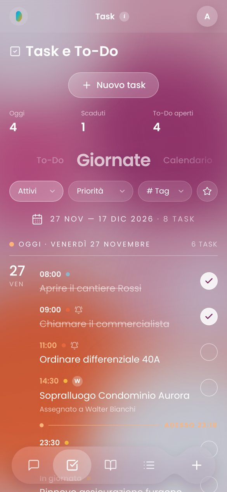 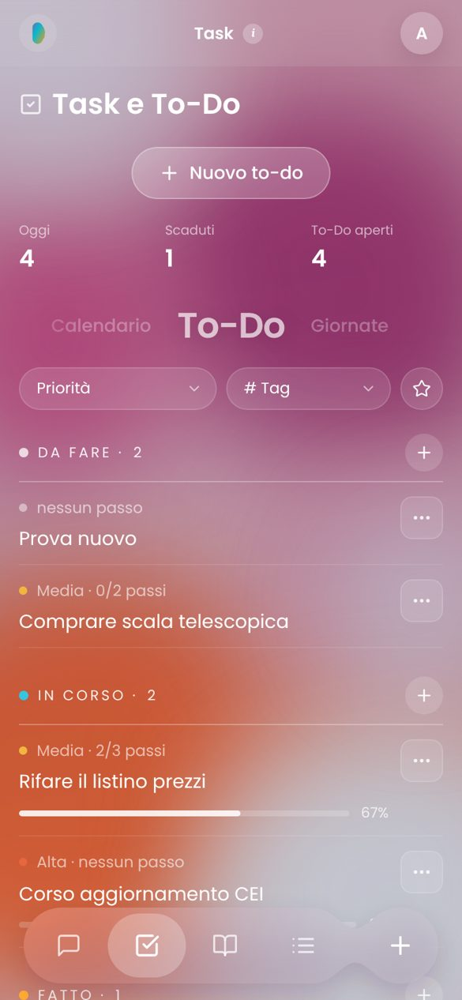 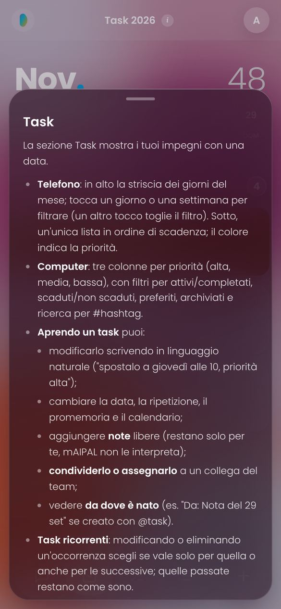

Una sola sezione, «Task» nei menu, titolo «Task e To-Do», fatta come il diario di commessa. L'indirizzo `?v=todo` / `?v=calendario` sceglie la vista (senza, Giornate).

- **In alto** le viste a parole grandi, come le sezioni del diario: **To-Do · Giornate · Calendario**; quella scelta al centro, un tocco o uno scorrimento su quelle di lato cambia vista. Niente titolo e niente indicatori: la barra in alto dice già «Task».
- **Una riga di filtri piccoli** (`PillSelect`, pillole alte 28 px; la tendina nativa invisibile sopra, a 16 px, così l'iPhone non ingrandisce): Attivi/Fatti (solo task), Priorità, # (tag, solo se ce ne sono), stella dei preferiti; a destra **+ task** / **+ to-do**.
- **Giornate**: ogni task su **una riga**: ora (o «—»), pallino di priorità, titolo, tondo per completare. **Oggi** per primo (numero del giorno a sinistra, task per `due_time`, linea **«Adesso HH:MM»**), poi il riquadro **Scaduti** (giorno corto: «Ieri», «24 nov»), poi i giorni per **mese**, in fondo «Senza data».
- **Calendario**: il mese con i pallini delle priorità; oggi pieno, il giorno scelto con il bordo; sotto, i task di quel giorno.
- **To-Do**: tre gruppi **Da fare · In corso · Fatto** con il numero e il «+» (`NewTodoSheet` di `TodoFolders.jsx`). Riga: pallino di priorità, titolo, stellina, passi «n/m» a destra, barra sottile per In corso, menu **«…»** (`GlassMenu`: Sposta in, preferiti, Elimina).
- **Aprire un task**: la scheda di sempre (`TaskDialog`): modifica scrivendo, data e ora, **priorità** (prima si cambiava trascinando tra le colonne), ripetizione, promemoria, calendario, note, condivisione e assegnazione, eliminazione (per i ricorrenti: solo questo o anche i successivi).
- **Aprire un to-do**: il dettaglio a tutto schermo di sempre (`TodoDetail.jsx`, invariato): titolo, passi fatti, copertina con descrizione e foto, Avvio/Stato, note, **passi** (anche suggeriti dall'AI).
- **Sul computer**, con almeno 860 px per la sezione: i filtri in alto, poi Giornate (o Calendario, con «+ task») a sinistra e To-Do (con «+ to-do») a destra, affiancati; con meno spazio la pagina è quella del telefono.

### 4.4 To-Do

Sono dentro la sezione Task (vista To-Do, capitolo 4.3). `TodoFolders.jsx` tiene le cartelle di vetro usate da Documenti e il foglio «nuovo to-do».

### 4.5 Dashboard «Oggi» (artigiano, `TodayPage.jsx` → `TodayDashboard.jsx`)

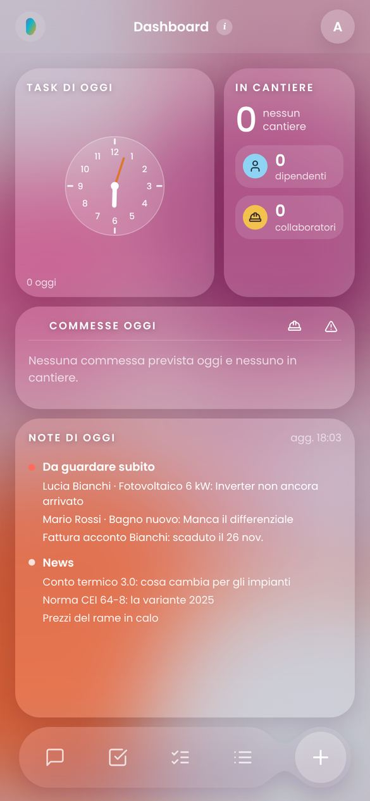 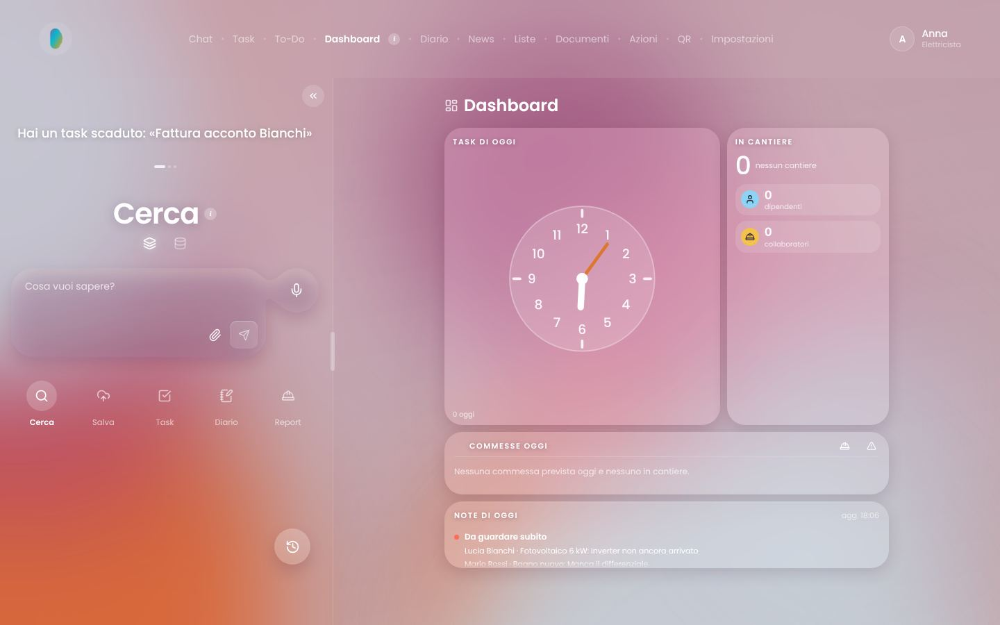

- **Task di oggi**: un orologio con i task del giorno.
- **In cantiere**: chi è in cantiere adesso (dipendenti e collaboratori).
- **Commesse oggi**: con le icone di stato.
- **Note di oggi**: cose da guardare subito, news, problemi.

### 4.6 Diario di commessa (artigiano, `JobDiaryPage.jsx`)

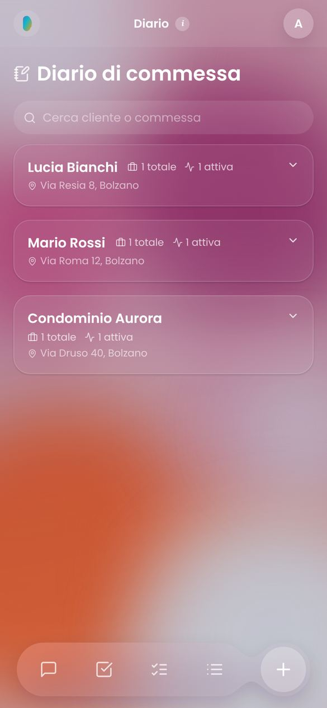 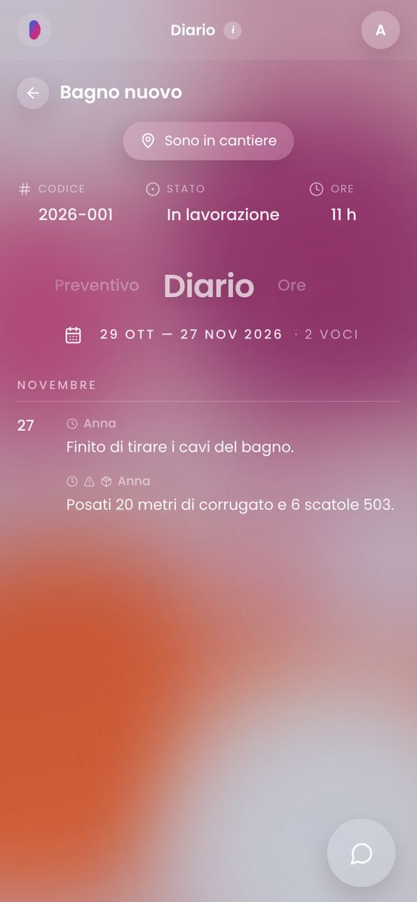 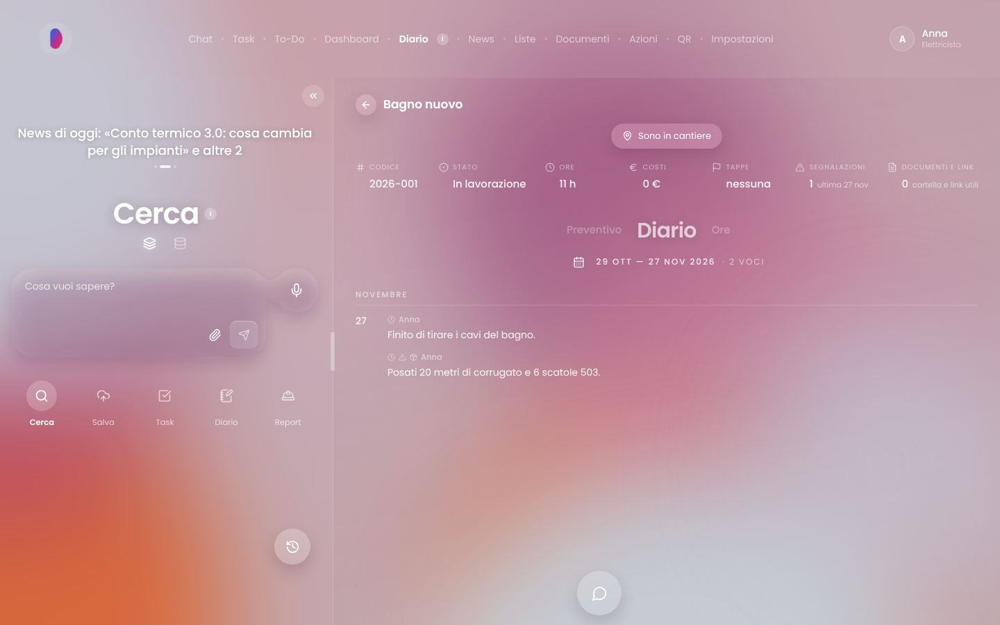

- **Elenco**: ricerca «Cerca cliente o commessa»; una scheda per **cliente** con il numero di commesse totali e attive e l'indirizzo. Si apre per mostrare le commesse.
- **Una commessa**:
  - freccia indietro e titolo; pulsante **«Sono in cantiere»** (arrivo e fine, con la posizione);
  - la **mappa del cantiere** (`SiteMapBand.jsx`) se c'è un indirizzo;
  - indicatori: codice, stato, ore, e sul computer anche costi, tappe e problemi;
  - le **schede scorrevoli** grandi **Preventivo · Diario · Ore**, e anche Problemi, Materiali, Tappe, Costi, Documenti, Contatti;
  - il **periodo** (calendario);
  - le voci raggruppate per mese e giorno, con autore e icone di cosa contengono (ore, problemi, materiali).
- **Chat della commessa**: il pulsante tondo in basso apre la chat legata a quella commessa, con tre modalità: **Chiedi**, **Diario**, **Report**.
- Il resto (tappe e attività, preventivi, lavori extra, condivisione, collaboratori, avanzamento al cliente) è descritto nella guida (`backend/help/mAIPAL-help.md`, sezioni diario-commessa e seguenti).

### 4.7 Diario personale (`JournalPage.jsx`, per chi non è artigiano)

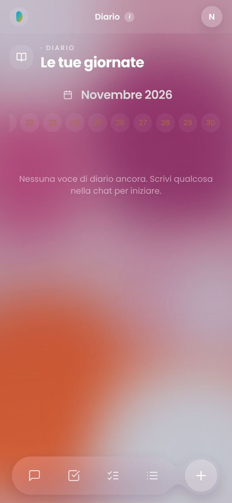

- «Le tue giornate»: il mese e la striscia dei giorni (i giorni con una voce sono pieni).
- Le voci sono come pagine di diario: righe sottili e un margine arancio (`.diary-page-lines`, `.diary-margin-line`).
- Ci sono filtri per periodo, umore e argomento. Si scrive dalla chat (agente Diario).

### 4.8 News (`NewsPage.jsx`)

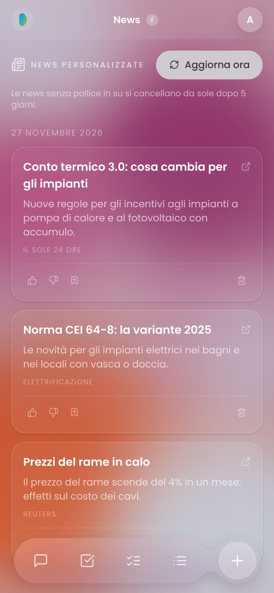

- «News personalizzate» con il pulsante **Aggiorna ora**.
- Una scheda per notizia: titolo, riassunto, fonte, pollice su/giù (impara le preferenze), link e cestino. Le news si cancellano dopo 5 giorni.

### 4.9 Liste (`CollectionsPage.jsx`)

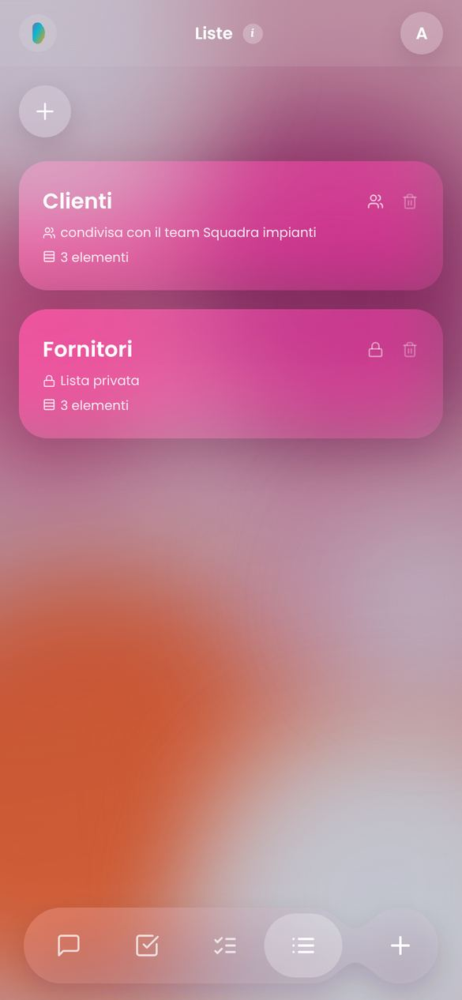 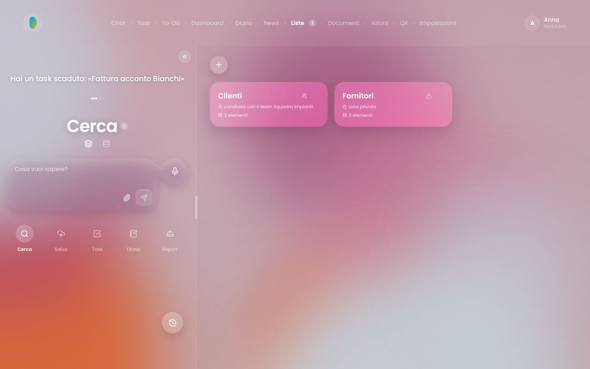

- Schede colorate per lista: nome, condivisione («condivisa con il team…» o «lista privata») e numero di elementi. Il «+» crea una lista.
- Per l'artigiano la lista **Clienti** contiene le **commesse**.
- Dentro una lista: righe con i campi; elementi annidati; modifica, ordinamento, condivisione per persona (modifica / sola lettura).

### 4.10 Documenti (`DocumentsPage.jsx`, `DocFolders.jsx`)

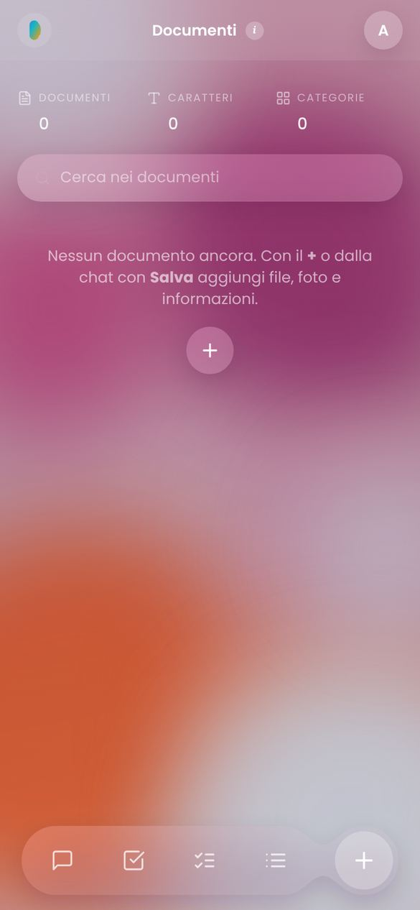

- Indicatori in alto: documenti, caratteri, categorie.
- Ricerca, cartelle per categoria e un documento per riga. Si aggiungono con il «+» o dalla chat (Salva).

### 4.11 Azioni (`ActionsPage.jsx`)

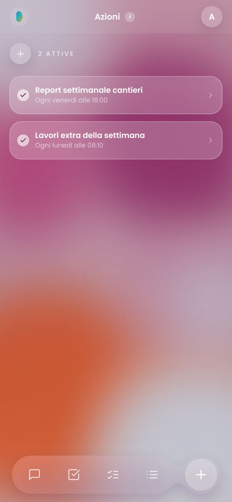

- Le azioni programmate attive (per esempio «Report settimanale cantieri – Ogni venerdì alle 18:00»).
- Ognuna si apre per vedere i dettagli, sospenderla o eliminarla. Si creano dalla chat (agente Azioni).

### 4.12 QR (`QrPage.jsx`, `QrScanPage.jsx`)

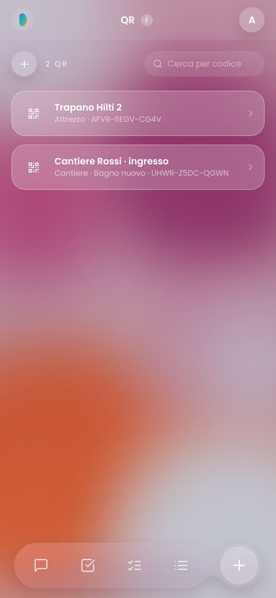 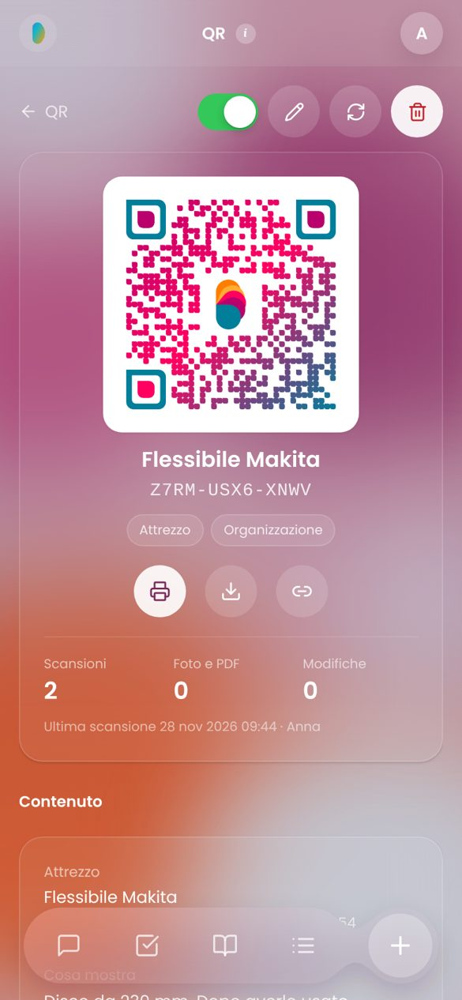 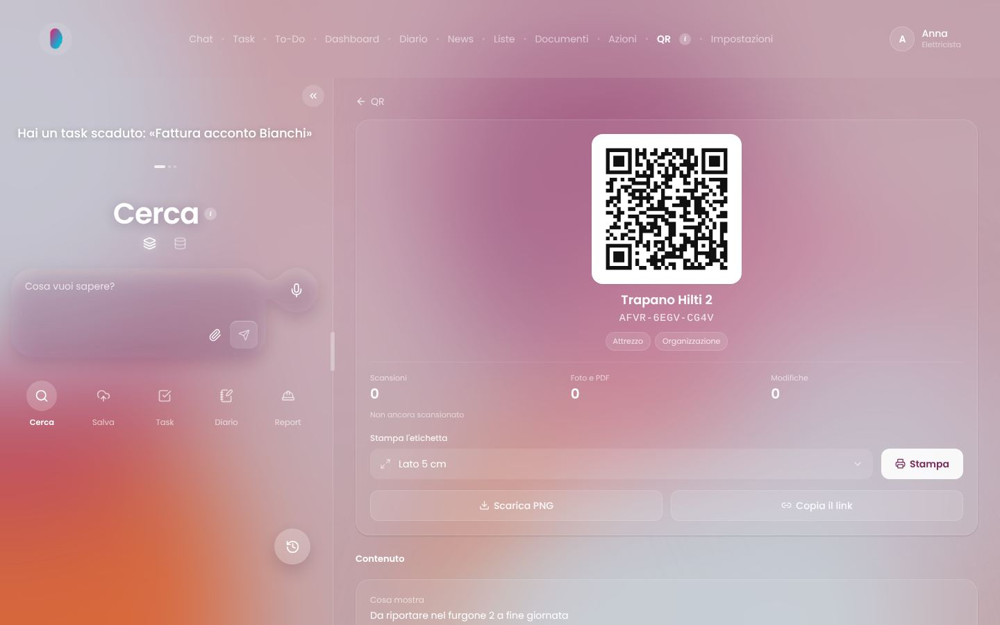

- **Elenco**: «+» per un nuovo QR, il conteggio e il campo **«Cerca per codice»**; una riga per QR con tipo e codice.
- **Un QR**:
  - in alto, accanto a «← QR»: l'interruttore Attivo (`IosSwitch`) e i pulsanti tondi Modifica, Nuovo codice, Elimina (cestino rosso su bianco, leggibile sullo sfondo);
  - il QR su fondo bianco, con nome, codice ed etichette; tre icone: **stampa** (apre `PrintSheet`, un `GlassBottomSheet` con il lato 3/5/8 cm), **scarica** PNG, **copia il link**;
  - gli indicatori Scansioni / Foto e PDF / Modifiche;
  - sotto: Contenuto (per un attrezzo: chi ce l'ha), Foto e PDF, Storico (chi ha preso l'attrezzo, le modifiche).
- **Nuovo / modifica**: per il tipo Attrezzo c'è il campo **Attrezzo** (`GET /qr/tools`: la lista Attrezzatura); «Nuovo» lo aggiunge alla lista con il nome del QR.
- **`/q/:codice`**: la pagina che si apre scansionando, anche per chi non ha l'app se il QR è pubblico: il contenuto da leggere (titolo grande, testo, foto, PDF e link), il controllo del luogo e, per un attrezzo, il riquadro con chi ce l'ha e **Prendi** / **Restituisci** (`POST /qr/scan/{codice}/tool`).
- La **realtà aumentata** è tolta dall'interfaccia (`QrArViewer.jsx` e `lib/arPose.js` restano nel codice, non più caricati; il server conserva le impostazioni).

### 4.13 Fitness (`FitnessPage.jsx`, verticale fitness)

- Lezioni, tipi di lezione, esercizi e attrezzi. Le lezioni si compongono dalla chat (agente Lezioni).

### 4.14 Impostazioni (`SettingsPage.jsx` e pannelli)

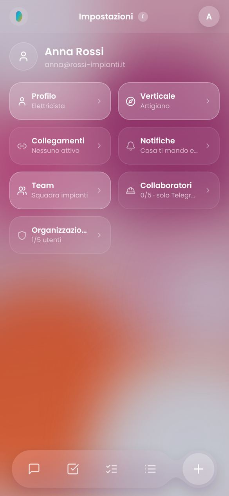 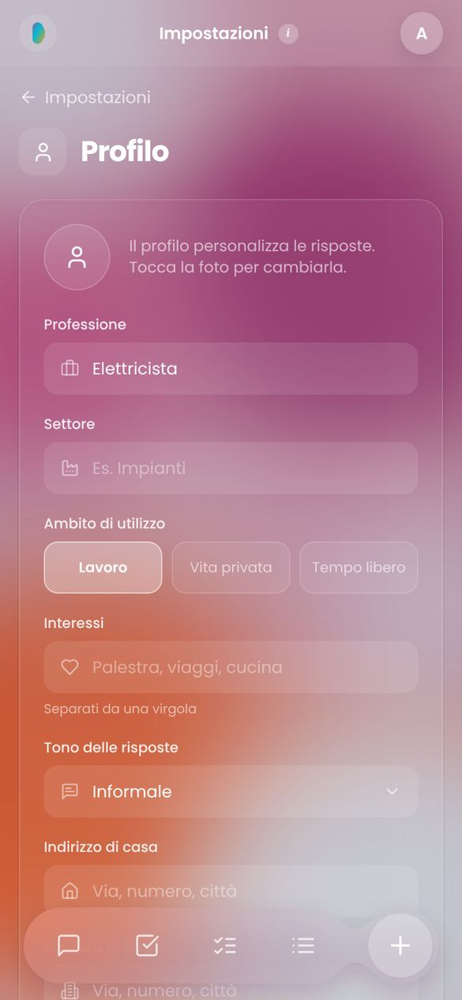 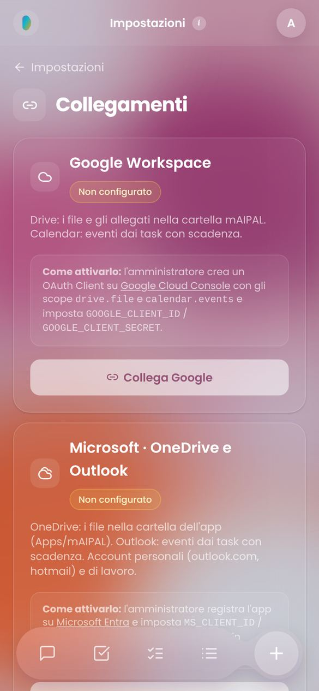 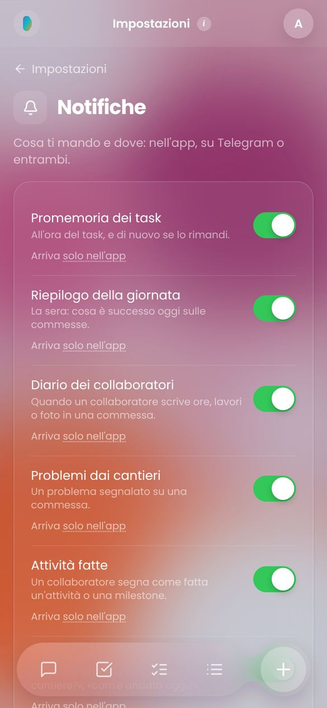
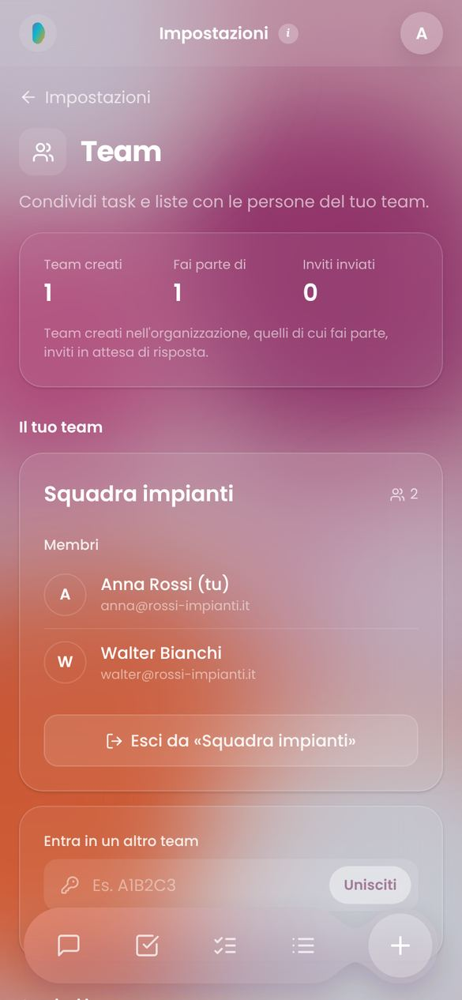 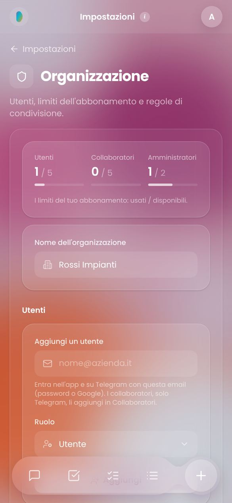 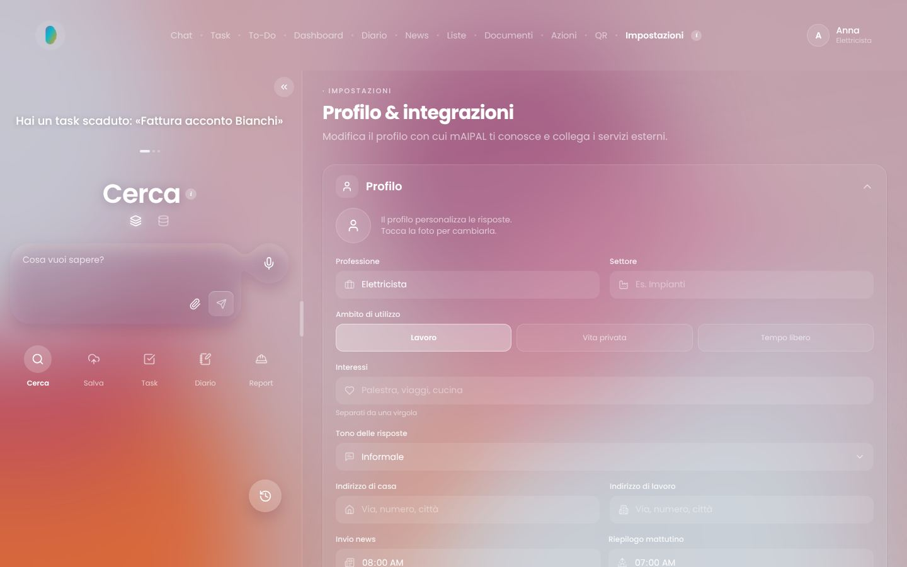

- **Telefono**: in alto l'utente (foto, nome, email), poi **riquadri** due per riga: Profilo, Verticale, Collegamenti, Notifiche, Team, Collaboratori, Organizzazione. Ogni riquadro ha titolo e stato; è acceso quando è attivo. Toccando si apre il pannello a tutta pagina con «← Impostazioni».
- **Computer**: un elenco di schede che si aprono e chiudono (`Section`), e la scelta resta sul dispositivo.
- **Profilo**:
  - foto;
  - professione, settore, ambito (tre pulsanti), interessi, tono (menu), indirizzi, orari;
  - **Salva profilo**;
  - per l'amministratore, **Logo organizzazione**.
- **Verticale**: tre riquadri (Veterinario, Fitness, Artigiano).
- **Collegamenti**:
  - Google e Microsoft: stato, account e un pulsante largo;
  - dove salvare file ed eventi, con interruttori;
  - Telegram: codice e «Apri»;
  - orologio: codice e orologi collegati.
- **Notifiche**: un interruttore per tipo, e dove arriva (app o Telegram).
- **Team**:
  - in alto gli indicatori (team creati / fai parte di / inviti);
  - il team attivo (menu) con i membri;
  - entrare con un codice;
  - per l'amministratore: «Nuovo team» e la scheda di gestione di ogni team.
- **Organizzazione** (amministratori):
  - in alto gli indicatori dell'abbonamento (utenti, collaboratori, amministratori usati / disponibili);
  - nome dell'organizzazione;
  - aggiungere un utente;
  - l'elenco con il menu «…» per persona;
  - regole di condivisione (interruttori);
  - automatismi.
- **Collaboratori** (artigiano): collaboratori esterni su Telegram, orario del controllo presenze, avanzamento ai clienti.

---

## 5. Componenti riutilizzati (`frontend/src/components`)

| Componente | A cosa serve |
|---|---|
| `PageBackground` | lo sfondo liquido |
| `LiquidDock`, `FloatingGlassButton` | la barra in basso e i pulsanti tondi galleggianti |
| `GlassMenu` (+ `GlassMenuItem`) | i menu a vetro (profilo, «…»), si aprono in su se manca spazio |
| `GlassBottomSheet`, `HelpSheet` | i fogli dal basso; la spiegazione di una sezione |
| `FormFields` | `Field`, `Input`, `Select`, `GroupTitle`, `PRIMARY` / `SECONDARY` / `DANGER`, `ICON_BTN`, `INLINE_BTN` |
| `StatTiles`, `IosSwitch` | indicatori numerici e interruttori |
| `InstallApp`, `OfflineStrip` | banner e dialogo di installazione; striscia senza rete |
| `SuggestionsTicker` | i suggerimenti in cima alla chat |
| `agentDrop/*` | le gocce 3D degli agenti |
| `TodayDashboard`, `PresencePill`, `OnSiteList`, `SiteMapBand` | dashboard, presenze, mappa del cantiere |
| `TodoFolders`, `TodoDetail` | to-do |
| `DocFolders` | documenti |
| `TeamPanel`, `CollaboratorsPanel`, `NotificationsPanel` | pannelli delle impostazioni |
| `CommessaShareSheet`, `CommessaContacts`, `ClientUpdatesSheet`, `DeleteWithCode` | condivisione, contatti, avanzamento, cancellazione protetta delle commesse |
| `QrArViewer` | realtà aumentata (per ora non usata) |
| `ui/*` | componenti shadcn (dialog, popover, calendar, toast…) |

---

## 6. Comportamenti che valgono ovunque

- **Accesso**:
  - cookie di sessione `session_token` (httpOnly) impostato dal server;
  - `AuthContext.jsx` legge `GET /auth/me` all'avvio. Senza utente si torna a `/`; senza primo avvio completato, a `/onboarding`.
- **Messaggi a comparsa**: `sonner` in basso a destra. Conferme come «Togli», «Elimina» o «Nuovo codice» sono toast con il pulsante d'azione e «Annulla» (8 secondi).
- **Tastiera sul telefono**: con un campo attivo la barra in basso sparisce. I pulsanti dei moduli usano `onMouseDown={preventDefault}`, così il campo resta attivo e il tocco non si perde.
- **Senza rete**:
  - le voci del diario (anche vocali) restano sul telefono (IndexedDB) e partono da sole quando la rete torna, nell'ordine e con il giorno in cui sono state scritte;
  - l'app si apre anche offline con gli ultimi dati.
- **Notifiche push**: alla prima apertura e ogni volta che l'app torna in primo piano, l'iscrizione del dispositivo viene inviata al server (`POST /push/subscribe`).
- **Preferenze del dispositivo** (`localStorage`):
  - `maipal.prefs`: lato del microfono, sezioni nella barra;
  - `maipal-theme`;
  - `maipal.chatOptions`: le opzioni degli agenti;
  - `maipal.split.*`: la vista divisa;
  - `maipal.settings.<sezione>`: le schede aperte o chiuse;
  - `maipal-install-banner-dismissed`.
- **Immagini**: prima del caricamento le foto vengono ridotte nel browser (JPEG, 1600–2560 px), così stanno nei limiti del server.
- **Accessibilità**: `aria-label` sui pulsanti a icona, focus visibile, rispetto di «riduci movimento» (animazioni spente).
- **Test**: quasi ogni elemento ha un `data-testid` stabile (per esempio `chat-textarea`, `send-btn`, `action-query`, `qr-save`), usato dalle prove automatiche con Playwright.

---

## 7. Come si comporta la chat con il server (il punto delicato)

`POST /chat/stream` è la chiamata principale degli agenti Cerca, Salva, Task, Diario e Help.

- **Corpo**: `{action, content, conv_id?, filters?, page?, images?, documents?, display_content?, ...}`, dove `action` è l'agente scelto.
- **Risposta**: `application/x-ndjson`, cioè una riga JSON per evento, letta a pezzi:
  - `{"type":"delta","content":"…"}`: un pezzo di testo della risposta, da accodare;
  - `{"type":"agent", "agent":…, "label":…, "status":…, "message":…}`: il risultato di un pezzo taggato con `@` o di un agente secondario;
  - `{"type":"help"}`: la risposta viene dalla guida (modalità Help);
  - `{"type":"error","content":"…"}`;
  - `{"type":"done","conv_id":"…"}`: fine; l'id della conversazione serve per i messaggi successivi.

Gli altri agenti hanno chiamate proprie, con risposte JSON che contengono **cosa mostrare** e **quali pulsanti**. Esempi:
- `POST /jobs/logs` (diario di commessa) restituisce `status: ok | ask | ...`, il messaggio, la commessa e le scelte;
- i report e le liste hanno le loro chiamate (`/work/report-chat`, `/work/reports/{id}/revise`, `/lists/update`).

L'app mostra i pulsanti solo in base a questi campi. **Con un nuovo modello questi formati devono restare identici.**

Le chiamate in cui il server usa un modello (quelle da ricontrollare dopo il cambio) sono:
- `/chat/stream`, `/agents/check`, `/agents/dispatch`, `/router/shadow`, `/classify-save-intent`;
- `/lists/update`, `/lists/create`;
- `/tasks/command`, `/todos/{id}/steps/suggest`;
- `/jobs/logs` e le chiamate della chat di commessa;
- `/work/*` (report), `/vet/*`;
- `/scheduled-actions/*` (bozza);
- `/fitness/generate-lesson`;
- `/voice/transcribe`;
- `/attachments/upload`, `/drive/smart-upload` (lettura e classificazione dei file).

---

## 8. Modificare e verificare l'app

```bash
cd frontend
yarn install                      # oppure npm install
npx craco start                   # sviluppo su http://localhost:3000 (REACT_APP_BACKEND_URL = il server)
CI=true npx craco test --watchAll=false
PUBLIC_URL=/general REACT_APP_BACKEND_URL=https://<dominio>/general npx craco build
```

- Le schermate di questo documento si rifanno così:
  1. un server di prova con un «modello finto» e dati di prova (come nei test di integrazione del backend);
  2. Playwright alle due misure 390×844 e 1440×900.
- Ogni nuova classe di colore bianco (`text-white/…`, `bg-white/…`, `border-white/…`) va aggiunta alle regole del tema chiaro in `index.css`.
- Ogni funzione visibile va descritta nella guida `backend/help/mAIPAL-help.md`, che è anche la «i» delle sezioni.

---

## 9. Le chiamate al server (il contratto da rispettare)

Ogni chiamata che l'app fa al server, divisa per file.
- `{…}` è un id o un valore variabile.
- Tutte sono sotto `/api` (dall'app: `https://<dominio>/general/api/...`), con il cookie di sessione.

Se si riscrive il server, o si cambia il modello dentro il server, **queste chiamate devono continuare a esistere con le stesse risposte**.

**`frontend/src/auth/AuthContext.jsx`**

- `POST /auth/logout`
- `GET /auth/me`

**`frontend/src/components/ClientUpdatesSheet.jsx`**

- `POST {…}/draft`
- `POST {…}/draft/decide`
- `POST {…}/invite`
- `DELETE {…}/link`
- `POST {…}/preview`
- `POST {…}/send`

**`frontend/src/components/CollaboratorsPanel.jsx`**

- `GET /collaborators`
- `POST /collaborators`
- `DELETE /collaborators/{…}`
- `PATCH /collaborators/{…}`
- `POST /collaborators/{…}/invite`
- `GET /jobs/commesse`

**`frontend/src/components/CommessaContacts.jsx`**

- `GET /jobs/commesse/{…}/contacts`
- `POST /jobs/commesse/{…}/contacts`
- `GET /jobs/contacts/directory`
- `DELETE /jobs/contacts/{…}`
- `PATCH /jobs/contacts/{…}`

**`frontend/src/components/DeleteWithCode.jsx`**

- `POST /clienti/delete-code`

**`frontend/src/components/HelpSheet.jsx`**

- `GET /help/sections`
- `GET /help/sections/{…}`

**`frontend/src/components/NotificationsPanel.jsx`**

- `GET /notify/prefs`
- `PUT /notify/prefs/{…}`
- `GET /push/key`
- `POST /push/status`
- `POST /push/subscribe`

**`frontend/src/components/PresencePill.jsx`**

- `POST /jobs/commesse/{…}/presence/start`
- `POST /jobs/logs`
- `POST /jobs/presence/break`
- `GET /jobs/presence/me`
- `POST /jobs/presence/pause`
- `POST /jobs/presence/still`
- `POST /jobs/presence/stop`

**`frontend/src/components/SuggestionsTicker.jsx`**

- `GET /suggestions`

**`frontend/src/components/TeamPanel.jsx`**

- `GET /admin/teams`
- `POST /admin/teams`
- `DELETE /admin/teams/{…}`
- `PATCH /admin/teams/{…}`
- `POST /admin/teams/{…}/invites`
- `DELETE /admin/teams/{…}/invites/{…}`
- `DELETE /admin/teams/{…}/members/{…}`
- `POST /admin/teams/{…}/regenerate-code`

**`frontend/src/components/TodayDashboard.jsx`**

- `GET /jobs/today`
- `PATCH /jobs/todos/{…}`
- `POST /tasks/{…}/complete`

**`frontend/src/components/TodoDetail.jsx`**

- `DELETE /todos/{…}`
- `PATCH /todos/{…}`
- `DELETE /todos/{…}/cover`
- `GET /todos/{…}/cover`
- `PUT /todos/{…}/cover`
- `POST /todos/{…}/favorite`
- `POST /todos/{…}/steps`
- `PUT /todos/{…}/steps/order`
- `POST /todos/{…}/steps/suggest`
- `DELETE /todos/{…}/steps/{…}`
- `PATCH /todos/{…}/steps/{…}`

**`frontend/src/components/TodoFolders.jsx`**

- `POST /todos`

**`frontend/src/lib/api.js`**

- `POST /chat/stream`

**`frontend/src/lib/outbox.js`**

- `POST /jobs/logs`
- `POST /voice/transcribe`
- `POST /work/report-chat`

**`frontend/src/pages/ActionsPage.jsx`**

- `GET /scheduled-actions`
- `DELETE /scheduled-actions/{…}`
- `PATCH /scheduled-actions/{…}`
- `POST /scheduled-actions/{…}/run`

**`frontend/src/pages/AdminPage.jsx`**

- `GET /tenant`
- `PATCH /tenant`
- `DELETE /tenant/invites/{…}`
- `GET /tenant/settings`
- `PATCH /tenant/settings`
- `POST /tenant/users`
- `DELETE /tenant/users/{…}`
- `PATCH /tenant/users/{…}`

**`frontend/src/pages/ChatPage.jsx`**

- `POST /agents/check`
- `POST /agents/dispatch`
- `POST /attachments/upload`
- `POST /classify-save-intent`
- `GET /conversations`
- `DELETE /conversations/{…}`
- `GET /conversations/{…}`
- `POST /conversations/{…}/favorite`
- `POST /drive/resolve-pending`
- `POST /drive/smart-upload`
- `POST /fitness/generate-lesson`
- `GET /integrations/status`
- `POST /jobs/commesse/drafts/{…}`
- `POST /jobs/logs`
- `POST /jobs/quotes/from-chat`
- `POST /jobs/quotes/{…}/confirm`
- `POST /jobs/quotes/{…}/discard`
- `DELETE /kb/documents/{…}`
- `POST /lists/create-from-text`
- `POST /lists/update`
- `POST /nearby`
- `POST /nearby/intent`
- `GET /org`
- `POST /router/shadow`
- `POST /scheduled-actions`
- `POST /scheduled-actions/interpret`
- `POST /tasks/command`
- `POST /tasks/command/apply`
- `POST /vet/generate-report`
- `GET /vet/templates`
- `POST /voice/transcribe`
- `POST /work/commessa-report`
- `POST /work/generate-report`
- `POST /work/report-chat`
- `POST /work/report-chat/{…}/set`
- `POST /work/reports/{…}/revise`
- `GET /work/templates`
- `POST {…}`

**`frontend/src/pages/CollectionsPage.jsx`**

- `GET /collections`
- `POST /collections`
- `PATCH /collections/reorder`
- `DELETE /collections/{…}`
- `GET /collections/{…}`
- `PATCH /collections/{…}`
- `POST /collections/{…}/folder`
- `GET /collections/{…}/items`
- `POST /collections/{…}/items`
- `PATCH /collections/{…}/items/reorder`
- `DELETE /collections/{…}/items/{…}`
- `PATCH /collections/{…}/items/{…}`
- `GET /collections/{…}/items/{…}/sub-items`
- `POST /collections/{…}/items/{…}/sub-items`
- `DELETE /collections/{…}/items/{…}/sub-items/{…}`
- `PATCH /collections/{…}/items/{…}/sub-items/{…}`
- `PUT /collections/{…}/sharing`
- `POST /jobs/commesse/{…}/folder`
- `GET /org`
- `GET /scheduled-actions`

**`frontend/src/pages/DashboardLayout.jsx`**

- `POST /push/subscribe`

**`frontend/src/pages/DocumentsPage.jsx`**

- `GET /integrations/status`
- `GET /kb/documents`
- `GET /kb/documents/categories`
- `DELETE /kb/documents/{…}`
- `PUT /kb/documents/{…}/org`

**`frontend/src/pages/FitnessPage.jsx`**

- `GET /clients`
- `POST /clients`
- `DELETE /clients/{…}`
- `PATCH /clients/{…}`
- `GET /exercises`
- `POST /exercises`
- `DELETE /exercises/{…}`
- `PATCH /exercises/{…}`
- `GET /fitness/equipment`
- `POST /fitness/equipment`
- `DELETE /fitness/equipment/{…}`
- `PATCH /fitness/equipment/{…}`
- `POST /fitness/generate-lesson`
- `GET /fitness/guidelines`
- `PUT /fitness/guidelines`
- `GET /fitness/lesson-types`
- `POST /fitness/lesson-types`
- `DELETE /fitness/lesson-types/{…}`
- `PATCH /fitness/lesson-types/{…}`
- `GET /lesson-templates`
- `DELETE /lesson-templates/{…}`
- `PATCH /lesson-templates/{…}`

**`frontend/src/pages/JobDiaryPage.jsx`**

- `PATCH /jobs/activities/{…}`
- `POST /jobs/activities/{…}/confirm`
- `POST /jobs/activities/{…}/done`
- `POST /jobs/activities/{…}/items`
- `DELETE /jobs/activities/{…}/items/{…}`
- `GET /jobs/commesse`
- `GET /jobs/commesse/{…}`
- `POST /jobs/commesse/{…}/activities`
- `POST /jobs/commesse/{…}/ask`
- `GET /jobs/commesse/{…}/collaborators`
- `PUT /jobs/commesse/{…}/collaborators/{…}`
- `PUT /jobs/commesse/{…}/description`
- `POST /jobs/commesse/{…}/documents`
- `GET /jobs/commesse/{…}/economics`
- `PATCH /jobs/commesse/{…}/economics`
- `GET /jobs/commesse/{…}/estimate`
- `POST /jobs/commesse/{…}/extra-works`
- `POST /jobs/commesse/{…}/extra-works/scan`
- `POST /jobs/commesse/{…}/extras`
- `DELETE /jobs/commesse/{…}/extras/{…}`
- `POST /jobs/commesse/{…}/folder`
- `PUT /jobs/commesse/{…}/geo`
- `POST /jobs/commesse/{…}/links`
- `DELETE /jobs/commesse/{…}/links/{…}`
- `PATCH /jobs/commesse/{…}/links/{…}`
- `POST /jobs/commesse/{…}/materials-plan/done`
- `POST /jobs/commesse/{…}/milestone-templates`
- `POST /jobs/commesse/{…}/milestones`
- `POST /jobs/commesse/{…}/milestones/from-template`
- `GET /jobs/commesse/{…}/plan-people`
- `PUT /jobs/commesse/{…}/prices`
- `POST /jobs/commesse/{…}/quote/outcome`
- `PATCH /jobs/commesse/{…}/stato`
- `POST /jobs/commesse/{…}/todos`
- `POST /jobs/commesse/{…}/variante`
- `PATCH /jobs/costs`
- `PATCH /jobs/extra-works/{…}`
- `POST /jobs/logs`
- `DELETE /jobs/logs/{…}`
- `GET /jobs/logs/{…}`
- `PATCH /jobs/logs/{…}`
- `POST /jobs/logs/{…}/hours-review`
- `DELETE /jobs/logs/{…}/photos/{…}`
- `POST /jobs/logs/{…}/plan-material`
- `PATCH /jobs/logs/{…}/problems/{…}`
- `GET /jobs/milestone-templates`
- `POST /jobs/milestone-templates`
- `DELETE /jobs/milestone-templates/{…}`
- `PATCH /jobs/milestone-templates/{…}`
- `DELETE /jobs/milestones/{…}`
- `PATCH /jobs/milestones/{…}`
- `POST /jobs/milestones/{…}/move`
- `POST /jobs/quotes/{…}/confirm`
- `POST /jobs/quotes/{…}/discard`
- `POST /jobs/quotes/{…}/option`
- `POST /jobs/quotes/{…}/value`
- `DELETE /jobs/todos/{…}`
- `PATCH /jobs/todos/{…}`
- `POST /jobs/todos/{…}/when`
- `POST /voice/transcribe`
- `POST /work/report-chat`
- `POST /work/report-chat/{…}/set`
- `POST /work/reports/{…}/revise`

**`frontend/src/pages/JournalPage.jsx`**

- `GET /journal`
- `DELETE /journal/{…}`
- `POST /journal/{…}/favorite`
- `DELETE /journal/{…}/images/{…}`

**`frontend/src/pages/NewsPage.jsx`**

- `GET /news`
- `POST /news/refresh`
- `DELETE /news/{…}`
- `POST /news/{…}/feedback`
- `POST /news/{…}/save-to-kb`

**`frontend/src/pages/OnboardingPage.jsx`**

- `GET /auth/me`
- `POST /onboarding`

**`frontend/src/pages/OrganizationPage.jsx`**

- `GET /org`
- `POST /org/invites/{…}/accept`
- `POST /org/invites/{…}/decline`
- `POST /org/join`
- `POST /org/leave`
- `POST /org/switch`

**`frontend/src/pages/QrPage.jsx`**

- `GET /jobs/commesse`
- `GET /qr`
- `POST /qr`
- `POST /qr/place-lookup`
- `DELETE /qr/{…}`
- `GET /qr/{…}`
- `PATCH /qr/{…}`
- `GET /qr/{…}/commessa-photos`
- `POST /qr/{…}/files`
- `POST /qr/{…}/files/from-photo`
- `DELETE /qr/{…}/files/{…}`
- `POST /qr/{…}/new-code`

**`frontend/src/pages/QrScanPage.jsx`**

- `GET /qr/public/{…}`
- `GET /qr/scan/{…}`

**`frontend/src/pages/SettingsPage.jsx`**

- `GET /integrations/google/authorize`
- `POST /integrations/google/disconnect`
- `GET /integrations/microsoft/authorize`
- `POST /integrations/microsoft/disconnect`
- `PUT /integrations/preferences`
- `GET /integrations/status`
- `POST /integrations/telegram/disconnect`
- `POST /integrations/telegram/link-code`
- `GET /org`
- `DELETE /org-logo`
- `GET /org-logo`
- `PATCH /org-logo`
- `POST /org-logo`
- `PATCH /profile`
- `POST /profile/avatar`
- `GET /watch/devices`
- `DELETE /watch/devices/{…}`
- `POST /watch/pair/confirm`

**`frontend/src/pages/TaskBoardPage.jsx`**

- `GET /org`
- `GET /tasks`
- `POST /tasks`
- `DELETE /tasks/{…}`
- `PATCH /tasks/{…}`
- `POST /tasks/{…}/assign`
- `POST /tasks/{…}/chat`
- `POST /tasks/{…}/complete`
- `POST /tasks/{…}/favorite`
- `GET /tasks/{…}/recurrence`
- `PUT /tasks/{…}/recurrence`
- `GET /todos`
- `PATCH /todos/{…}`
- `DELETE /todos/{…}`
- `POST /todos/{…}/favorite`

